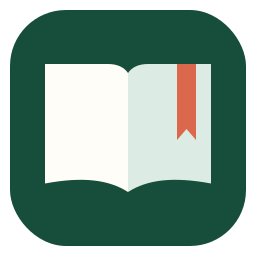

# My Vocabulary · 我的词汇本

Local-first vocabulary capture and adaptive review.

将英语词汇、固定搭配、阅读素材与生活口语统一收录并分开复习。

**技术栈 / Stack:** Python · SQLite · WPF · WebView2 · JavaScript



## 能做什么

- 本地粘贴识别、CSV 导入导出、标签和专业词汇分类。
- 累计错误参与自适应复习，支持单词与固定搭配组合复习。
- 搜索保留输入焦点和光标，阅读与集中复习各自有清晰入口。

## 安装与运行

Python 3.11+。Python 后端使用标准库，首次启动自动建立空数据库。

```powershell
python start.py
```

浏览器备用入口：http://127.0.0.1:8766/ 。Windows 原生桌面壳另需 .NET 8 SDK 与 WebView2 Runtime：

```powershell
powershell -NoProfile -File scripts/build_desktop_app.ps1
powershell -NoProfile -File scripts/create_windows_launcher.ps1
```

词库、复习历史和个人导入素材未公开；新克隆从空词库开始。

## 验证

```powershell
python -m pip install -r requirements-dev.txt
python -m unittest discover -s tests
dotnet build desktop/MyVocabulary.Desktop/MyVocabulary.Desktop.csproj -c Release
```

命令结果与验收范围见 [VALIDATION.md](VALIDATION.md)。这些检查不能替代目标机器上的原生桌面验收。

## 添加单词与开始复习

在添加页录入英文和中文，可附同义词、易混词和标签，也可使用 CSV 模板批量导入。阅读素材与生活口语独立收纳。

复习提供五个范围、三种可见作答方式：从全局复习、最近添加、错词重练、易混词专项或今日单词选择内容，再以遮罩自评、看中文写英文或挖空补全作答。学习模式适合先熟悉新内容。

## 备份与恢复

数据位于 `data/vocabulary.db`。关闭桌面应用并等待后台退出后，整体复制 `data` 目录；恢复前先另存当时的数据，再在应用关闭时替换备份，避免丢失之后新增的学习记录。

## 发布范围

[公开源码说明](PUBLICATION.md) · [全部作品](https://github.com/YUANYZ-cell)
